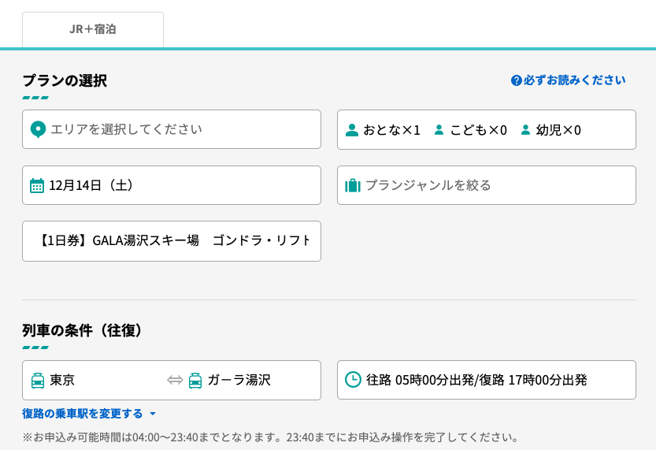

# ⛷️ ガーラ湯沢

[← スキー](1572fd7b-67a8-80c3-97a2-c6b3507fd68e.md)

### 天気

- [https://weathernews\.jp/onebox/36\.950010/138\.799532/q=ガーラ湯沢（新潟県）&amp;v=b12dd63d5001980d1bfaf55ddff7dbbbd8aa0a2206ac8d3fbd1d4b17084bb7c4&amp;temp=c&amp;lang=ja](https://weathernews.jp/onebox/36.950010/138.799532/q=%E3%82%AC%E3%83%BC%E3%83%A9%E6%B9%AF%E6%B2%A2%EF%BC%88%E6%96%B0%E6%BD%9F%E7%9C%8C%EF%BC%89&v=b12dd63d5001980d1bfaf55ddff7dbbbd8aa0a2206ac8d3fbd1d4b17084bb7c4&temp=c&lang=ja)

- [https://tenki\.jp/season/ski/4/18/13155/condition\.html](https://tenki.jp/season/ski/4/18/13155/condition.html)

- 日付決め打ち

  - [https://tenki\.jp/past/2024/12/22/amedas/4/18/54841\.html](https://tenki.jp/past/2024/12/22/amedas/4/18/54841.html)

## 0\. 事前知識

- レンタル情報

  - [https://www\.notion\.so/hinoshiba/15d2fd7b67a8808ea6ccc6af2065f516?pvs=4](https://www.notion.so/hinoshiba/15d2fd7b67a8808ea6ccc6af2065f516?pvs=4)

- 新潟スキー場

  - [https://gala\.co\.jp/winter/](https://gala.co.jp/winter/)

- JRの駅が、スキー場と概ね直結

  - JRの駅から、レンタルやロッカーの複合施設にそのまま繋がっている

    - 一回も外出ないで、スキー場まで行ける

  - JRの駅は、スキー場の数100m 下にある

    - ゴンドラにも繋がっており、レンタルetcしたら、スキーの格好で数100mゴンドラ登ると、スキー場エリア

- スキー場エリアには、水や飲食店がある（が高い）

- JRの駅の商業施設に、入浴施設がある

  - スキー → サウナ → 帰宅新幹線 が、丸っと1日遊んでいい感じコース

  - 上記工程のためには、新幹線の出る、3h前には、ふもとまで戻ってくる形が吉

## 1\. 申し込み

### 1\. 新幹線&amp;リフト券

- ダイナミックレールパックが安い

  - キーワードは、 <code>JR ski ski ガーラ湯沢</code> とか。

- 新幹線は、到着時間を見る。8時に開くから、　7:58着とかがおすすめ

  - 快速的なやつで、所要時間が短いのあるから、出発時間じゃダメ

- キャンペーンページが誕生しておらず、直接検索するのであれば、こういうノリ

  

  

- 号車推奨は、車種による。予約状況の密度とかを参考にすると良さそう

### 2\. レンタル

- 事前申し込みURL

  - [https://gala\.co\.jp/winter/rental/](https://gala.co.jp/winter/rental/)

- グローブとかは無いよ！

  - 厚めの靴下、インナー、ゴーグル、ヘルメット、グローブ etcは必要に応じて

- サイズは、最悪当日変更できる

  - ただし、物交換時には、再度、レンタルの列に並ぶ必要がある

  - 大人サイズだと、第一段階リフト登ったところでも交換できるから、一回すべってみて微妙だったら、上の休憩所で変えるとかも可能

## 2\. 事前準備

1. JR券売機で、チケット発券しておく

   1. 最寄りのJR  みどりの窓口や、新幹線対応の券売機で発券可

1. レンタル品のサイズ等を登録しておく

1. リフト券の、QRコードを用意しておく

   1. 旅行工程表のQRコード付きPDFとして、えきねっとからDLできる

   1. 電波悪くて手間取らないように、スクショ

1. レンタル品の、QRコードを用意しておく

   1. 電波悪くて手間取らないように、スクショ

## 3\. 当日

1. 降りたら、QRコードだして、リフト券を受け取る

   - 人がいる受付っぽい窓口には行かない（左手奥に機械があって、QRコードかざせばおk）

1. レンタルの列に並ぶ

   - 列はどんどん伸びる。当日手書き申し込み勢がいる

   - 設備の並び順の関係で、リフト券が先だが、すでにレンタルの列が伸びてきているのであれば、レンタルの列に並んじゃう

1. ロッカー 1000円

   - 何度も開けられる。結構でかい。2人で1つとかできそう

   - 荷物が小さすぎるのであれば、ロッカー借りない or ゴンドラ登った上にある休憩所の300円ロッカーを使う

     - こちらは何度も開けられないので注意

1. ゴンドラで上に上がる

## 4\. スキー後

- SPAガーラの湯

  - 温泉とフィットネスプールがある。リフト券に割引券ついてる

    - 1000円で入れる\(2024年時点\)

  - サウナは狭い。6名ギリ

  - フィットネスプールがある。使う場合は水着がいる

---

## その他

### 予算感について

ざっくり、29,000円 / 人 \(ウェア持ってるならば、\-5,500円するノリ\)

- ダイナミックレールパック 1万円周辺

- スキーレンタル  6,500円

- ウェア 5,500円

- ロッカー 1,000円

- ご飯\(昼/夜\) 2,000円 x 2

- 風呂/サウナ 1,000円\(2024年時点\)

- 飲料水何回か買う代 1,000円

### 予習動画

- [https://www\.youtube\.com/watch?v=m5WjQkGJivw](https://www.youtube.com/watch?v=m5WjQkGJivw)

- [https://www\.youtube\.com/watch?v=Jo8HgHB73xo](https://www.youtube.com/watch?v=Jo8HgHB73xo)　

